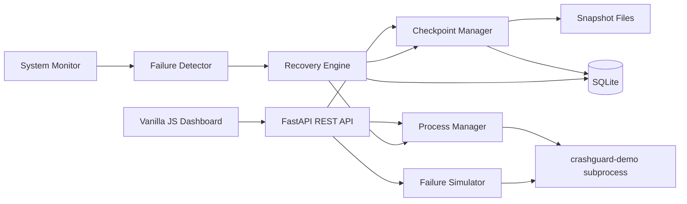

# CrashGuard: Intelligent System Failure Recovery & Checkpointing Framework

CrashGuard is a user-space Operating Systems project that monitors an isolated demo process, creates full and incremental checkpoints of its state, detects controlled failures, and restores the process from the most recent valid checkpoint.

It is intentionally safe for college demonstrations: it does not modify boot settings, registry entries, system files, security tools, or arbitrary processes. The failure simulator only controls the `crashguard-demo` subprocess.

## Problem Statement

Long-running systems can fail because of crashes, hangs, resource pressure, or corrupted application state. CrashGuard demonstrates how a recovery supervisor can reduce downtime by periodically checkpointing state, detecting failures, rolling back to a known-good snapshot, and measuring Recovery Time Objective (RTO).

## Motivation

The project makes OS fault-tolerance concepts visible and testable. Instead of showing a static dashboard, every major action calls a backend operation: starting a process, checkpointing state, corrupting state, detecting failure, restoring state, restarting the process, and recording recovery history.

## Features

- Process lifecycle management for a separate Python demo process
- CPU, RAM, disk, process status, uptime, checkpoint count, and recovery count monitoring
- Full checkpoint for the first snapshot
- Incremental checkpointing using state diffs for later snapshots
- SQLite metadata and JSON snapshot files
- SHA-256 checksum validation and state schema validation
- Controlled failure simulation: crash, hang, memory stress, state corruption, random failure
- Automatic recovery with latest/safest/manual/automatic policies
- Recovery history with RTO
- Structured event logs in SQLite and `logs/crashguard.log`
- Dark technical dashboard with real-time polling

## Architecture



## Folder Structure

```text
CrashGuard/
├── backend/
│   ├── main.py
│   ├── monitor.py
│   ├── checkpoint.py
│   ├── recovery.py
│   ├── failure_detector.py
│   ├── failure_simulator.py
│   ├── process_manager.py
│   ├── metrics.py
│   ├── logger.py
│   ├── models.py
│   ├── database.py
│   ├── demo_worker.py
│   └── config.py
├── checkpoints/
│   ├── metadata/
│   └── snapshots/
├── frontend/
│   ├── index.html
│   ├── style.css
│   └── script.js
├── logs/
├── tests/
├── requirements.txt
└── README.md
```

## Technologies

- Python 3.11+
- FastAPI
- Uvicorn
- psutil
- SQLite
- Pydantic
- HTML, CSS, Vanilla JavaScript

## Installation

```bash
python -m venv .venv
.venv\Scripts\activate
pip install -r requirements.txt
```

On Linux/macOS:

```bash
python3 -m venv .venv
source .venv/bin/activate
pip install -r requirements.txt
```

## Running

```bash
uvicorn backend.main:app --reload
```

Open:

```text
http://127.0.0.1:8000
```

## API Documentation

FastAPI also exposes interactive docs at:

```text
http://127.0.0.1:8000/docs
```

Core endpoints:

```text
GET    /api/system/status
GET    /api/system/metrics
GET    /api/process
POST   /api/process/start
POST   /api/process/stop
POST   /api/checkpoints/create
GET    /api/checkpoints
GET    /api/checkpoints/{id}
DELETE /api/checkpoints/{id}
POST   /api/checkpoints/{id}/restore
POST   /api/failure/crash
POST   /api/failure/hang
POST   /api/failure/corrupt
POST   /api/failure/memory
POST   /api/failure/random
GET    /api/recovery/history
GET    /api/recovery/status
POST   /api/recovery/policy
GET    /api/events
```

## Database Schema

`checkpoints`

- `id`, `checkpoint_id`, `timestamp`, `state_size`
- `checkpoint_type`: `full` or `incremental`
- `process_id`, `status`, `checksum`, `snapshot_path`
- `base_checkpoint_id`, `storage_savings`, `validation_reason`

`recovery_events`

- `id`, `failure_type`, `failure_time`, `detection_time`
- `recovery_start`, `recovery_end`, `recovery_duration`, `rto`
- `checkpoint_used`, `recovery_status`

`system_events`

- `id`, `timestamp`, `level`, `event_type`, `message`, `checkpoint_id`, `status`

`configuration`

- `key`, `value`

## OS Concepts Demonstrated

- Process management: starting, stopping, restarting, and supervising a subprocess
- Process states: running, stopped, hung, corrupted
- Process monitoring: periodic observation through a background monitor
- Failure detection: crash, hang, memory threshold, and state corruption classification
- Checkpointing: full and incremental user-space snapshots
- Rollback and recovery: restoring previous application state after failure
- State persistence: SQLite metadata and JSON snapshot files
- File I/O: atomic state file updates and snapshot storage
- Inter-process concepts: supervisor process communicates with demo process through command/state files
- Resource monitoring: CPU, RAM, disk, and process memory through psutil
- Scheduling: periodic polling loop for health checks
- Recovery policies: latest, safest, manual, and automatic
- Reliability metrics: RTO measurement and recovery history

CrashGuard does not implement kernel-level checkpoint/restore. It is a user-space framework designed to safely demonstrate OS fault-tolerance principles.

## System Workflow

```text
Failure Detected
       ↓
Identify Failure
       ↓
Select Valid Checkpoint
       ↓
Terminate or Reset Failed Demo Process
       ↓
Restore Checkpoint State
       ↓
Restart Process
       ↓
Verify State
       ↓
Record RTO and Recovery Status
```

## Demo Procedure

1. Run `uvicorn backend.main:app --reload`.
2. Open `http://127.0.0.1:8000`.
3. Click `Start` in Active Process.
4. Watch counter, task, and progress change.
5. Click `Create Checkpoint`.
6. Wait a few seconds so the state advances.
7. Click `Create Checkpoint` again and observe `INCREMENTAL`.
8. Trigger `Process Crash`.
9. Wait for the monitor to detect the stopped process.
10. Watch recovery select the newest valid checkpoint.
11. Confirm the process restarts and state rolls back near the checkpointed value.
12. Read RTO and event history in the Recovery Console.

## Testing

```bash
pytest
```

The tests cover checkpoint creation, incremental restore, validation failure, invalid restore, failure detection, recovery timing, process restart, and an end-to-end crash/restore flow.

## Screenshots

Add screenshots of your running dashboard here after launching the app during your submission/demo.

## Limitations

- User-space state checkpointing only; no kernel memory image capture.
- The demo process is intentionally simple so the recovery flow remains inspectable.
- Incremental snapshots use field-level JSON diffs, not block-level filesystem snapshots.
- Memory stress is capped to remain safe on student machines.

## Future Enhancements

- WebSocket streaming for lower-latency event delivery
- Checkpoint pruning policies
- Snapshot compression
- Multi-process supervision
- Exportable incident reports
- More detailed resource threshold tuning

## Viva Questions and Answers

**Q: Is CrashGuard kernel-level checkpointing?**  
A: No. It is user-space checkpointing. It snapshots application-level state safely for OS concept demonstration.

**Q: What makes incremental checkpointing different here?**  
A: The first checkpoint stores the full state. Later checkpoints store only fields that changed compared with the previous reconstructed checkpoint.

**Q: How does CrashGuard detect a process hang?**  
A: The demo process updates a heartbeat timestamp. If the monitor sees the heartbeat exceed the timeout, it classifies a hang.

**Q: How is checkpoint corruption detected?**  
A: Snapshot files include a SHA-256 checksum. CrashGuard recalculates it, verifies parseability, required fields, and the full state hash before restore.

**Q: What is RTO?**  
A: Recovery Time Objective is represented as the measured duration between recovery start and recovery end.

**Q: Why use SQLite?**  
A: SQLite gives persistent, queryable metadata for checkpoints, recoveries, events, and configuration without requiring a separate database server.

**Q: Why is the failure simulator safe?**  
A: It sends commands only to the isolated demo subprocess and never targets host OS files or arbitrary processes.
